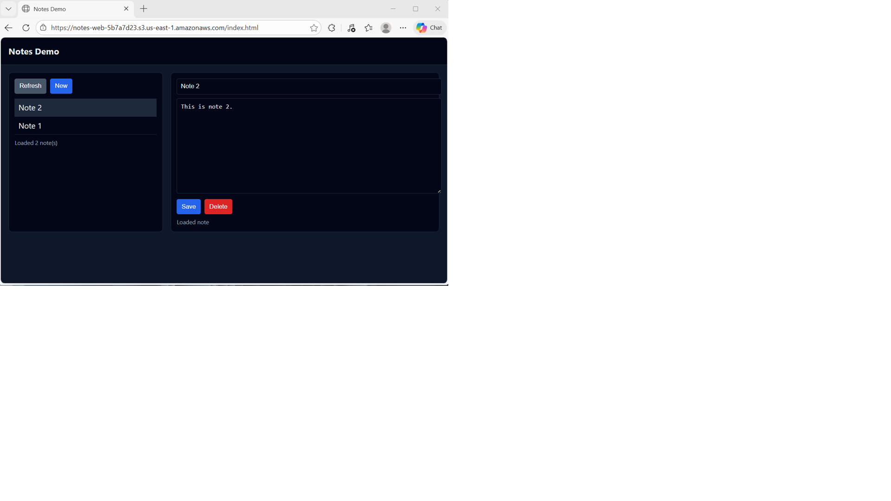
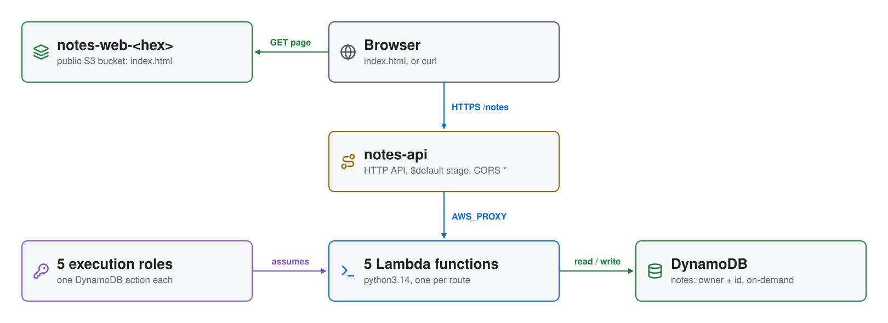

# Serverless CRUD API on AWS: API Gateway, Lambda and DynamoDB

A small serverless **notes** API with a browser front end. An **API Gateway
HTTP API** routes five CRUD endpoints to five **Lambda** functions, which
store notes in **DynamoDB**. A single-page web app, served from a public
**S3** bucket, calls the API from the browser.



| Piece | Where | Role |
|---|---|---|
| **notes-api** | API Gateway, us-east-1 | HTTP API, auto-deployed `$default` stage; five routes, each an `AWS_PROXY` integration; CORS allows any origin |
| **Lambda functions** | us-east-1 | `create-note`, `list-notes`, `get-note`, `update-note`, `delete-note`; Python 3.14, 15 s timeout, all from `code/notes.py` |
| **Execution roles** | IAM | one per function: CloudWatch Logs plus the single DynamoDB action it needs |
| **notes** | DynamoDB | on-demand table keyed on `owner` (partition) and `id` (sort) |
| **notes-web-&lt;hex&gt;** | S3 | public-read bucket holding `index.html` and `favicon.ico` |

## Architecture

<picture>
  <source media="(prefers-color-scheme: dark)" srcset="architecture-dark.svg">
  
</picture>

Regenerate with `python3 make_diagram.py`.

- **`01-lambdas/`**: `api.tf` (API, routes, integrations, stage, invoke
  permissions), `dynamodb.tf`, one `lambda-*.tf` per function with its role,
  and the handlers in `code/notes.py`.
- **`02-webapp/`**: the bucket, its public-read policy, and
  `index.html.tmpl`, which `apply.sh` fills in with the API URL.

## API

There's no authentication. Every note belongs to the hardcoded owner
`"global"`, so listing is a DynamoDB `Query` on that partition rather than a
scan.

| Method | Path | Function | DynamoDB | Returns |
|---|---|---|---|---|
| POST | `/notes` | `create-note` | `PutItem` | `201` `{id, title, note}`; `400` if `title` or `note` is missing |
| GET | `/notes` | `list-notes` | `Query` | `{"items": [...]}` |
| GET | `/notes/{id}` | `get-note` | `GetItem` | the note, or `404` |
| PUT | `/notes/{id}` | `update-note` | `UpdateItem` | the updated note; `404` if it doesn't exist |
| DELETE | `/notes/{id}` | `delete-note` | `DeleteItem` | `{"message": "Note deleted"}`, or `404` |

Each note gets a UUID `id` and `created_at` / `updated_at` timestamps. Update
and delete use a condition on `id`, so a missing note returns `404` instead
of being created or silently ignored.

```bash
curl -s -X POST https://<api-id>.execute-api.us-east-1.amazonaws.com/notes \
  -H "Content-Type: application/json" \
  -d '{"title":"Test Note 1","note":"This is test note 1"}'
```

```json
{
  "id": "2f2d0c5a-9f5f-4d7d-9e2c-1c8a5b8e3c21",
  "title": "Test Note 1",
  "note": "This is test note 1"
}
```

## Prerequisites

* [An AWS Account](https://aws.amazon.com/console/)
* [Install AWS CLI](https://docs.aws.amazon.com/cli/latest/userguide/getting-started-install.html)
* [Install Terraform](https://developer.hashicorp.com/terraform/install)
* [Install jq](https://jqlang.github.io/jq/download/) and `envsubst`

If this is your first time following along, we recommend starting with this
video: [AWS + Terraform: Easy Setup](https://www.youtube.com/watch?v=9clW3VQLyxA).

## Deploy

```bash
git clone https://github.com/mamonaco1973/aws-crud-example.git
cd aws-crud-example
./apply.sh
```

Everything deploys to `us-east-1`. `apply.sh` applies `01-lambdas`, looks up
the `notes-api` endpoint, renders `02-webapp/index.html` from the template
with `envsubst`, and applies `02-webapp`. It ends by running `validate.sh`,
which creates five notes, lists them, fetches, updates and deletes each one:

```
NOTE: Created note 1 (id=2f2d0c5a-9f5f-4d7d-9e2c-1c8a5b8e3c21)
...
NOTE: List endpoint returned 5 notes
...
NOTE: Deleted note 2f2d0c5a-9f5f-4d7d-9e2c-1c8a5b8e3c21

=================================================================================
  Deployment validated!
=================================================================================
  API : https://<api-id>.execute-api.us-east-1.amazonaws.com
  Web : https://notes-web-<hex>.s3.amazonaws.com/index.html
=================================================================================
```

## Try it

1. Open the **Web** URL and add, edit and delete notes in the page.
2. Or use `curl` against the **API** URL with the routes above.

## Teardown

```bash
./destroy.sh
```

## Notes

- **Lab only.** The API has no authentication and allows CORS from any
  origin, and the web bucket is public.
- `check_env.sh` doesn't check for `envsubst`, which `apply.sh` needs.
